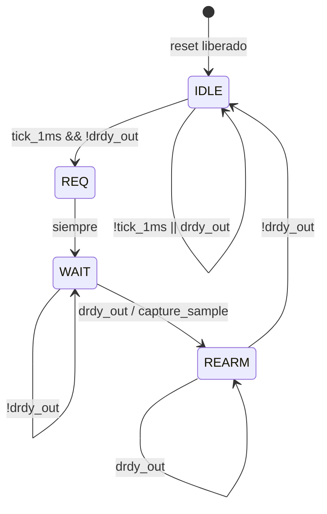

# M1 — XADC Interface

**Proyecto:** ELDI-Dimmer-FPGA  
**Fecha del avance:** 3 de noviembre de 2026  
**Estado:** Diseño revisado; preparación para implementación RTL.  
**Módulo:** `xadc_interface`  
**Plataforma:** Digilent Nexys 4 DDR — Artix-7  
**Herramienta:** Vivado 2026.1  

## 1. Objetivo del módulo

El módulo `xadc_interface` (M1) proporciona la interfaz entre el XADC Wizard generado en Vivado y la lógica digital del sistema.

Su función es obtener las muestras digitalizadas del potenciómetro y entregarlas al módulo M3 mediante las señales `pot_sample` y `sample_valid`.

## 2. Trabajo realizado

Durante esta etapa se revisó la configuración real del XADC Wizard generado en Vivado. Se inspeccionaron:

- Los puertos disponibles en la instancia `xadc_wiz_1`.
- El template de instanciación generado por Vivado.
- El archivo envolvente `xadc_wiz_1.v`.
- La configuración y versión de la IP.
- Las conexiones del canal auxiliar VAUX3.
- La interfaz DRP utilizada para consultar los resultados de conversión.
- Las señales de control y estado disponibles.

**Importante:** todavía no se ha implementado `xadc_interface.v`, no se ha construido su testbench y no se ha realizado una simulación funcional de M1.

## 3. Decisiones confirmadas

| Elemento | Decisión |
|---|---|
| Módulo | `xadc_interface` |
| FPGA | Nexys 4 DDR — Artix-7 |
| Reloj del sistema | 100 MHz |
| IP del convertidor | `xadc_wiz_1` |
| Versión de IP | XADC Wizard 3.3, revisión 15 |
| Interfaz de acceso | DRP |
| Entrada analógica | VAUX3 |
| Señales analógicas | `vauxp3`, `vauxn3` |
| Dirección del registro | `7'h13` |
| Tipo de operación | Lectura (`DWE = 0`) |
| Datos útiles | 12 bits en `DO[15:4]` |
| Salida hacia M3 | `pot_sample[11:0]` |
| Indicador de muestra | `sample_valid` |
| Retención | Conservar la última muestra válida hasta recibir otra lectura válida |

## 4. Comportamiento de las muestras

Cuando se completa una lectura válida:

1. Se captura `do_out[15:4]` en `pot_sample`.
2. Se genera un pulso de un ciclo de reloj en `sample_valid`.
3. En los ciclos posteriores, `sample_valid` vuelve a cero.
4. `pot_sample` conserva su valor hasta recibir una nueva lectura válida.

Durante el reset de la lógica M1, `pot_sample` se inicializa en cero.

## 5. Protocolo DRP

De acuerdo con UG480:

- `DEN` debe activarse durante un único ciclo de DCLK.
- `DWE = 0` selecciona una operación de lectura.
- `DADDR` contiene la dirección del registro consultado.
- `DO` se captura cuando `DRDY` indica que los datos están disponibles.
- No se inicia una nueva transacción hasta que `DRDY` vuelva a cero.

## 6. FSM de control aprobada para referencia RTL

El diseño de la FSM queda aprobado como referencia para la implementación RTL. Esta aprobación documenta la secuencia y las decisiones de control; no significa que exista RTL ni que su comportamiento se haya verificado funcionalmente.

### 6.1. Estados y codificación

| Estado | Código | Función |
|---|---:|---|
| `IDLE` | `2'b00` | Esperar `tick_1ms` con `drdy_out` bajo para iniciar una lectura. |
| `REQ` | `2'b01` | Solicitar una lectura DRP durante un ciclo. |
| `WAIT` | `2'b10` | Esperar la respuesta indicada por `drdy_out`. |
| `REARM` | `2'b11` | Esperar que `drdy_out` vuelva a cero antes de aceptar otra solicitud. |

### 6.2. Entradas y tabla completa de transición

`tick_1ms` es un pulso de un ciclo generado por el temporizador de M1. `drdy_out` es la respuesta DRDY de la IP XADC. En estados donde la entrada no afecta la transición, se indica `X` (no importa).

| Estado actual | `tick_1ms` | `drdy_out` | Estado siguiente |
|---|---:|---:|---|
| `IDLE` | 0 | 0 | `IDLE` |
| `IDLE` | 0 | 1 | `IDLE` |
| `IDLE` | 1 | 0 | `REQ` |
| `IDLE` | 1 | 1 | `IDLE` |
| `REQ` | X | X | `WAIT` |
| `WAIT` | X | 0 | `WAIT` |
| `WAIT` | X | 1 | `REARM` |
| `REARM` | X | 0 | `IDLE` |
| `REARM` | X | 1 | `REARM` |

### 6.3. Señales de control y captura

| Señal | Definición de referencia | Función |
|---|---|---|
| `den_out` (`DEN`) | 1 únicamente en `REQ`; 0 en los demás estados | Inicia la transacción DRP con un pulso de un ciclo. |
| `dwe_out` (`DWE`) | 0 | Selecciona lectura. |
| `daddr_out` (`DADDR`) | `7'h13` | Selecciona el registro de datos de VAUX3 según la configuración revisada. |
| `capture_sample` | `(state == WAIT) && drdy_out` | Habilita la captura de `do_out[15:4]` en `pot_sample` y la generación de un pulso de un ciclo en `sample_valid`. |

La captura se realiza en el primer flanco de reloj en que la FSM está en `WAIT` y `drdy_out` está activo. En ese flanco la transición conduce a `REARM`. `pot_sample` conserva la última muestra válida y `sample_valid` se desactiva en los ciclos siguientes.

### 6.4. Ecuaciones de próximo estado

Sean `Q1:Q0` los bits del estado actual y `Q1+:Q0+` los bits del estado siguiente, con la codificación de la tabla. Las ecuaciones aprobadas son:

- `Q1+ = ¬Q1·Q0 + Q1·¬Q0 + Q1·Q0·D`.
- `Q0+ = ¬Q1·¬Q0·T·¬D + Q1·D`.

En estas ecuaciones, `T = tick_1ms` y `D = drdy_out`. Con `IDLE=00`, `REQ=01`, `WAIT=10` y `REARM=11`, la tabla de transición cubre sus combinaciones y es equivalente a las ecuaciones.

### 6.5. Diagrama de estados

## 7. Temporizador y relación con la FSM

Se plantea utilizar un contador de 17 bits con reloj de 100 MHz (periodo de reloj de 10 ns) y conteo habilitado de 0 a 99 999, equivalente a 100 000 ciclos habilitados para el intervalo de 1 ms. El temporizador está habilitado durante la espera en `IDLE` cuando `drdy_out` está bajo. La solicitud se produce cuando `tick_1ms = 1` y `drdy_out = 0`. El intervalo de conteo habilitado no equivale necesariamente al periodo real entre solicitudes: el tiempo en otros estados o con `drdy_out` alto puede extender dicho periodo.

La secuencia de estados impide solicitar otra lectura hasta que la respuesta anterior haya sido observada y `drdy_out` haya vuelto a cero.

## 8. Reset

Se debe distinguir entre:

- `rst`: reset de la lógica propia de M1, síncrono y activo en alto en esta referencia. Al muestrearlo activo, la FSM vuelve a `IDLE`, `pot_sample` se inicializa en cero, `sample_valid` se limpia y las señales de solicitud DRP quedan inactivas (`DEN=0`, `DWE=0`, `DADDR=7'h13`).
- `reset_in`: reset de la IP XADC, conectado respetando las características de la primitiva.

La documentación UG480 identifica el reset del XADC como activo en alto y asíncrono. No se debe modificar el comportamiento interno de la IP generada por Vivado. Fuera del reset, `pot_sample` conserva la última muestra válida.

## 9. Aspectos pendientes

1. Confirmar en RTL la habilitación del temporizador durante la espera en `IDLE` con `drdy_out` bajo y la alineación con `rst`.
2. Definir la secuencia de liberación del reset durante la integración.
3. Confirmar la correspondencia definitiva de los puertos externos con M3.
4. Implementar y revisar el RTL conforme a la FSM aprobada.
5. Construir el testbench y ejecutar la simulación.
6. Validar el comportamiento con la IP XADC y el potenciómetro.

## 10. Plan de verificación

### Etapa 1 — Revisión RTL

- Comprobar que `DEN` dura un ciclo.
- Verificar `DWE = 0`.
- Verificar `DADDR = 7'h13`.
- Confirmar que la captura depende de `DRDY`.
- Comprobar el rearme antes de una nueva solicitud.

### Etapa 2 — Registro de muestra

- Confirmar la captura de los 12 bits correctos.
- Confirmar la retención del último valor válido.
- Confirmar que `sample_valid` dura un ciclo.
- Comprobar el comportamiento durante reset.

### Etapa 3 — Temporización

- Comprobar el contador de 1 ms.
- Verificar la secuencia de solicitudes y respuestas DRP.
- Comprobar que no se generen solicitudes repetidas durante una transacción activa.

### Etapa 4 — Simulación

- Ejecutar el testbench.
- Cubrir todas las transiciones de la tabla de la FSM, incluidos ticks ignorados fuera de `IDLE` y `drdy_out` sostenido durante `REARM`.
- Probar diferentes respuestas de `DRDY`.
- Comprobar reset y retención de datos.
- Revisar las formas de onda.

### Etapa 5 — Prueba física

- Integrar la IP XADC generada por Vivado.
- Programar la Nexys 4 DDR.
- Variar el potenciómetro.
- Comprobar que `pot_sample` cambia de acuerdo con la entrada analógica.

## 11. Estado del módulo

| Actividad | Estado |
|---|---|
| Inspección de la IP XADC | Completada |
| Identificación de puertos DRP | Completada |
| Identificación de VAUX3 | Completada |
| Revisión del protocolo DRP | Completada |
| Definición de retención de muestra | Confirmada |
| Definición de `sample_valid` | Confirmada |
| Diseño de FSM de cuatro estados, codificación, transiciones y controles | Aprobado como referencia RTL; no verificado funcionalmente |
| Implementación RTL | Pendiente |
| Testbench | Pendiente |
| Simulación | Pendiente |
| Prueba física | Pendiente |

## 12. Conclusión

M1 cuenta con una base técnica revisada, el comportamiento de retención de muestras definido y el diseño de la FSM aprobado como referencia para el RTL. El diseño todavía no está implementado ni verificado funcionalmente. El siguiente paso es construir la implementación RTL en Verilog, sin modificar la IP generada por Vivado.

La integración con M3 se realizará después de verificar individualmente el funcionamiento de M1.
