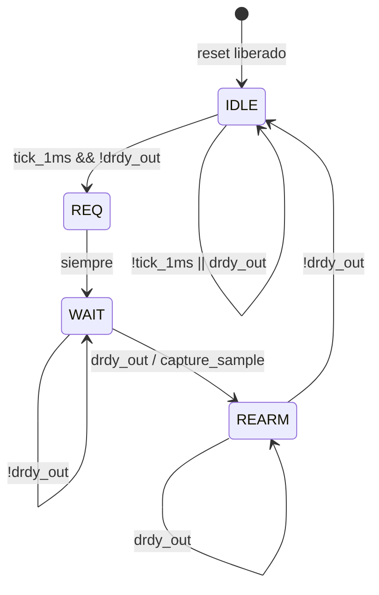

# M1 — XADC Interface

**Proyecto:** ELDI-Dimmer-FPGA  
**Fecha del avance:** 10 de noviembre de 2026
**Estado:** Control digital implementado y secuencia observada en simulación; adquisición analógica pendiente de validar.
**Módulo:** `xadc_interface`  
**Plataforma:** Digilent Nexys 4 DDR — Artix-7  
**Herramienta:** Vivado 2026.1  

## 1. Objetivo del módulo

El módulo `xadc_interface` (M1) proporciona la interfaz entre el XADC Wizard generado en Vivado y la lógica digital del sistema.

Su función es obtener las muestras digitalizadas del potenciómetro y entregarlas al módulo M3 mediante las señales `pot_sample` y `sample_valid`.

## 2. Trabajo realizado

Durante esta etapa se revisó la configuración real del XADC Wizard generado en Vivado. Se inspeccionaron:

- Los puertos disponibles en la instancia `xadc_wiz_1`.
- El template de instanciación generado por Vivado.
- El archivo envolvente `xadc_wiz_1.v`.
- La configuración y versión de la IP.
- Las conexiones del canal auxiliar VAUX3.
- La interfaz DRP utilizada para consultar los resultados de conversión.
- Las señales de control y estado disponibles.

El avance del 10 de noviembre incorpora la implementación del control digital de M1 y una simulación compartida. La secuencia de la FSM y algunas señales de control se observaron, pero el resultado no demuestra que el XADC esté realizando conversiones analógicas útiles. No se ha completado la verificación del protocolo DRP ni la validación física.

## 2.1. Configuración del XADC observada

| Parámetro | Valor observado |
|---|---|
| IP | XADC Wizard 3.3, revisión 15 |
| Canal | VAUXP3/VAUXN3 (VAUX3) |
| Modo | Continuous, Single Channel |
| Interfaz | DRP habilitada |
| DCLK | 100 MHz |
| Divisor de reloj | 4 |
| Frecuencia ADC calculada | 25 MHz |
| Tasa de conversión solicitada | 1000 KSPS |
| Tasa mostrada | 961.54 KSPS |
| Monitor de simulación | `design.txt` |
| Estímulo revisado | `VAUXP[3]`: 0.50–0.51 V; `VAUXN[3]`: 0 V |

La configuración y el estímulo se documentan como observados; aún debe confirmarse que `design.txt` aplica efectivamente la entrada al modelo XADC. No se modificaron los archivos HDL generados por Vivado.

## 2.2. Implementación digital y testbench compartidos

Se implementó la FSM de cuatro estados con lógica combinacional de siguiente estado y registro secuencial de estado con reset síncrono activo alto. El temporizador de 17 bits cuenta de 0 a 99 999 y se habilita en `IDLE` cuando `DRDY` está bajo. El control DRP establece `DEN` activo durante `REQ`, `DWE = 0`, `DADDR = 7'h13` y `DI = 16'h0000`. También se escribió en el código compartido la instancia de XADC Wizard con sus conexiones DRP. La captura toma `DO[15:4]` en `pot_sample`, emite `sample_valid` durante un ciclo y conserva la última muestra válida.

El testbench compartido usa un reloj de 100 MHz (semiperiodo de 5 ns), un reset inicial de 100 ns y mantiene `vauxp3` y `vauxn3` en cero. El estímulo analógico se proporciona mediante `design.txt`; la interacción de ese archivo con el modelo del IP todavía debe confirmarse.

## 3. Decisiones confirmadas

| Elemento | Decisión |
|---|---|
| Módulo | `xadc_interface` |
| FPGA | Nexys 4 DDR — Artix-7 |
| Reloj del sistema | 100 MHz |
| IP del convertidor | `xadc_wiz_1` |
| Versión de IP | XADC Wizard 3.3, revisión 15 |
| Interfaz de acceso | DRP |
| Entrada analógica | VAUX3 |
| Señales analógicas | `vauxp3`, `vauxn3` |
| Dirección del registro | `7'h13` |
| Tipo de operación | Lectura (`DWE = 0`) |
| Datos útiles | 12 bits en `DO[15:4]` |
| Salida hacia M3 | `pot_sample[11:0]` |
| Indicador de muestra | `sample_valid` |
| Retención | Conservar la última muestra válida hasta recibir otra lectura válida |

## 4. Comportamiento de las muestras

Cuando se completa una lectura válida:

1. Se captura `do_out[15:4]` en `pot_sample`.
2. Se genera un pulso de un ciclo de reloj en `sample_valid`.
3. En los ciclos posteriores, `sample_valid` vuelve a cero.
4. `pot_sample` conserva su valor hasta recibir una nueva lectura válida.

Durante el reset de la lógica M1, `pot_sample` se inicializa en cero.

## 5. Protocolo DRP

De acuerdo con UG480:

- `DEN` debe activarse durante un único ciclo de DCLK.
- `DWE = 0` selecciona una operación de lectura.
- `DADDR` contiene la dirección del registro consultado.
- `DO` se captura cuando `DRDY` indica que los datos están disponibles.
- No se inicia una nueva transacción hasta que `DRDY` vuelva a cero.

## 6. FSM de control aprobada para referencia RTL

El diseño de la FSM queda aprobado como referencia para la implementación RTL. Esta aprobación documenta la secuencia y las decisiones de control; no significa que exista RTL ni que su comportamiento se haya verificado funcionalmente.

### 6.1. Estados y codificación

| Estado | Código | Función |
|---|---:|---|
| `IDLE` | `2'b00` | Esperar `tick_1ms` con `drdy_out` bajo para iniciar una lectura. |
| `REQ` | `2'b01` | Solicitar una lectura DRP durante un ciclo. |
| `WAIT` | `2'b10` | Esperar la respuesta indicada por `drdy_out`. |
| `REARM` | `2'b11` | Esperar que `drdy_out` vuelva a cero antes de aceptar otra solicitud. |

### 6.2. Entradas y tabla completa de transición

`tick_1ms` es un pulso de un ciclo generado por el temporizador de M1. `drdy_out` es la respuesta DRDY de la IP XADC. En estados donde la entrada no afecta la transición, se indica `X` (no importa).

| Estado actual | `tick_1ms` | `drdy_out` | Estado siguiente |
|---|---:|---:|---|
| `IDLE` | 0 | 0 | `IDLE` |
| `IDLE` | 0 | 1 | `IDLE` |
| `IDLE` | 1 | 0 | `REQ` |
| `IDLE` | 1 | 1 | `IDLE` |
| `REQ` | X | X | `WAIT` |
| `WAIT` | X | 0 | `WAIT` |
| `WAIT` | X | 1 | `REARM` |
| `REARM` | X | 0 | `IDLE` |
| `REARM` | X | 1 | `REARM` |

### 6.3. Señales de control y captura

| Señal | Definición de referencia | Función |
|---|---|---|
| `den_out` (`DEN`) | 1 únicamente en `REQ`; 0 en los demás estados | Inicia la transacción DRP con un pulso de un ciclo. |
| `dwe_out` (`DWE`) | 0 | Selecciona lectura. |
| `daddr_out` (`DADDR`) | `7'h13` | Selecciona el registro de datos de VAUX3 según la configuración revisada. |
| `capture_sample` | `(state == WAIT) && drdy_out` | Habilita la captura de `do_out[15:4]` en `pot_sample` y la generación de un pulso de un ciclo en `sample_valid`. |

La captura se realiza en el primer flanco de reloj en que la FSM está en `WAIT` y `drdy_out` está activo. En ese flanco la transición conduce a `REARM`. `pot_sample` conserva la última muestra válida y `sample_valid` se desactiva en los ciclos siguientes.

### 6.4. Ecuaciones de próximo estado

Sean `Q1:Q0` los bits del estado actual y `Q1+:Q0+` los bits del estado siguiente, con la codificación de la tabla. Las ecuaciones aprobadas son:

- `Q1+ = ¬Q1·Q0 + Q1·¬Q0 + Q1·Q0·D`.
- `Q0+ = ¬Q1·¬Q0·T·¬D + Q1·D`.

En estas ecuaciones, `T = tick_1ms` y `D = drdy_out`. Con `IDLE=00`, `REQ=01`, `WAIT=10` y `REARM=11`, la tabla de transición cubre sus combinaciones y es equivalente a las ecuaciones.

### 6.5. Diagrama de estados

## 7. Temporizador y relación con la FSM

Se plantea utilizar un contador de 17 bits con reloj de 100 MHz (periodo de reloj de 10 ns) y conteo habilitado de 0 a 99 999, equivalente a 100 000 ciclos habilitados para el intervalo de 1 ms. El temporizador está habilitado durante la espera en `IDLE` cuando `drdy_out` está bajo. La solicitud se produce cuando `tick_1ms = 1` y `drdy_out = 0`. El intervalo de conteo habilitado no equivale necesariamente al periodo real entre solicitudes: el tiempo en otros estados o con `drdy_out` alto puede extender dicho periodo.

La secuencia de estados impide solicitar otra lectura hasta que la respuesta anterior haya sido observada y `drdy_out` haya vuelto a cero.

## 8. Reset

Se debe distinguir entre:

- `rst`: reset de la lógica propia de M1, síncrono y activo en alto en esta referencia. Al muestrearlo activo, la FSM vuelve a `IDLE`, `pot_sample` se inicializa en cero, `sample_valid` se limpia y las señales de solicitud DRP quedan inactivas (`DEN=0`, `DWE=0`, `DADDR=7'h13`).
- `reset_in`: reset de la IP XADC, conectado respetando las características de la primitiva.

La documentación UG480 identifica el reset del XADC como activo en alto y asíncrono. No se debe modificar el comportamiento interno de la IP generada por Vivado. Fuera del reset, `pot_sample` conserva la última muestra válida.

## 9. Resultados de simulación y limitaciones

### 9.1. Observado en simulación

- Secuencia `IDLE → REQ → WAIT → REARM → IDLE`.
- Pulso `DEN` durante `REQ`.
- Activación de `capture_sample` cuando `WAIT` y `DRDY` coinciden.
- Pulso `sample_valid` asociado a la captura.
- `do_out[15:0]` observado en cero y `pot_sample[11:0]` observado en cero.
- `busy_out`, `eoc_out` y `channel_out` observados en cero durante los intervalos mostrados.

Estas observaciones confirman actividad de la secuencia digital en los intervalos revisados. La observación de la FSM no demuestra que la adquisición analógica esté funcionando correctamente.

### 9.2. Pendiente de validar

- Conversión analógica útil del XADC y obtención de un valor correcto y no nulo en `pot_sample`.
- Aplicación efectiva del estímulo de `design.txt` al modelo XADC.
- Actividad interna del XADC, ampliando la escala temporal de la simulación.
- Verificación completa del protocolo DRP e integración con el IP real.

## 10. Aspectos pendientes

1. Completar la verificación de la habilitación del temporizador en `IDLE` con `drdy_out` bajo y su alineación con `rst`.
2. Definir la secuencia de liberación del reset durante la integración.
3. Confirmar la correspondencia definitiva de los puertos externos con M3.
4. Completar la revisión RTL conforme a la FSM aprobada.
5. Ejecutar y ampliar las pruebas del testbench compartido según los casos pendientes.
6. Validar el comportamiento con la IP XADC y el potenciómetro.

## 11. Plan de verificación

Los 14 casos de esta lista siguen **pendientes de verificación**. Las observaciones visuales ya registradas en la sección 9.1 son evidencia de señales en los intervalos mostrados, pero no equivalen a aprobar estos casos.

| N.º | Caso de verificación | Estado / nota |
|---:|---|---|
| 1 | Aplicar el reset inicial y comprobar el estado y las salidas de reset. | Pendiente de verificación. |
| 2 | Comprobar cuándo ocurre el primer `DEN` respecto de los 100 000 ciclos habilitados del temporizador. | Pendiente; comprobar y documentar la convención de conteo y el flanco asociado. |
| 3 | Verificar durante `REQ` `DADDR = 7'h13`, `DWE = 0` y `DI = 16'h0000`. | Pendiente de verificación. |
| 4 | Probar latencias de `DRDY` de 1, 4 y 20 ciclos. | Pendiente; comprobar y documentar la convención de conteo y los flancos observados. |
| 5 | Probar los datos límite `16'hFFF0`, `16'h0000` y `16'h8000`. | Pendiente; no se fija aquí un resultado de conversión esperado. |
| 6 | Comprobar que los bits `DO[3:0]` no afectan `pot_sample`, manteniendo controlados los bits superiores. | Pendiente de verificación. |
| 7 | Comprobar que `sample_valid` dura un ciclo y está alineado con la actualización de `pot_sample`. | Pendiente; existe una observación visual de un pulso asociado a la captura. |
| 8 | Comprobar que se produce una sola solicitud `DEN` por lectura. | Pendiente de verificación. |
| 9 | Mantener `DRDY` alto durante varios ciclos y comprobar el rearme conforme a la FSM aprobada. | Pendiente de verificación. |
| 10 | Comprobar el comportamiento cuando `DRDY` está alto en `IDLE` al vencer el temporizador. | Pendiente de verificación conforme a la tabla de transiciones aprobada. |
| 11 | Aplicar reset durante `WAIT` y comprobar el comportamiento definido para el reset síncrono activo alto. | Pendiente de verificación. |
| 12 | Comprobar la ausencia de `DRDY`: la implementación actual permanece en `WAIT` mientras `DRDY` no se active. | Pendiente de verificación. Un timeout es una mejora propuesta, no una función implementada. |
| 13 | Medir la periodicidad entre lecturas considerando los ciclos adicionales de `REQ`, `WAIT` y `REARM`. | Pendiente; comprobar y documentar la convención de conteo. |
| 14 | Integrar con el IP XADC real y confirmar que `design.txt` aplica efectivamente el estímulo al modelo. | Pendiente de verificación. |

### Cobertura de transiciones de la FSM

Todas las transiciones siguientes están pendientes de cobertura mediante simulación con comprobación automática. La observación visual anterior no equivale a cobertura completa.

- `IDLE → REQ`: `tick_1ms = 1` y `drdy_out = 0`.
- `IDLE → IDLE`: cualquier otra combinación de entradas.
- `REQ → WAIT`: transición incondicional.
- `WAIT → WAIT`: `drdy_out = 0`.
- `WAIT → REARM`: `drdy_out = 1`.
- `REARM → REARM`: `drdy_out = 1`.
- `REARM → IDLE`: `drdy_out = 0`.

## 11. Estado del módulo

| Actividad | Estado |
|---|---|
| Inspección de la IP XADC | Completada |
| Identificación de puertos DRP | Completada |
| Identificación de VAUX3 | Completada |
| Revisión del protocolo DRP | Completada |
| Definición de retención de muestra | Confirmada |
| Definición de `sample_valid` | Confirmada |
| Diseño de FSM de cuatro estados, codificación, transiciones y controles | Implementado conforme a la referencia aprobada; secuencia observada, verificación funcional completa pendiente |
| Implementación del control digital RTL | Completada en el código compartido |
| Instancia XADC y conexiones DRP en código compartido | Escritas; conversión analógica por validar |
| Testbench compartido | Disponible; casos de verificación pendientes |
| Observación de secuencia de control en simulación | Observada en los intervalos mostrados; no valida la adquisición analógica |
| Verificación completa DRP y de datos | Pendiente |
| Conversión analógica útil y prueba física | Pendientes |

## 12. Conclusión

M1 cuenta con el control digital implementado en el código compartido y la secuencia de control observada en simulación. La configuración del XADC y el estímulo de simulación están registrados, pero las salidas de datos observadas permanecieron en cero y la aplicación efectiva de `design.txt` al modelo aún debe confirmarse. La adquisición analógica, la verificación completa DRP y la prueba física siguen pendientes; por tanto, M1 no está completamente validado. No se modificaron los archivos HDL generados por Vivado.

La integración con M3 se realizará después de verificar individualmente el funcionamiento de M1.
